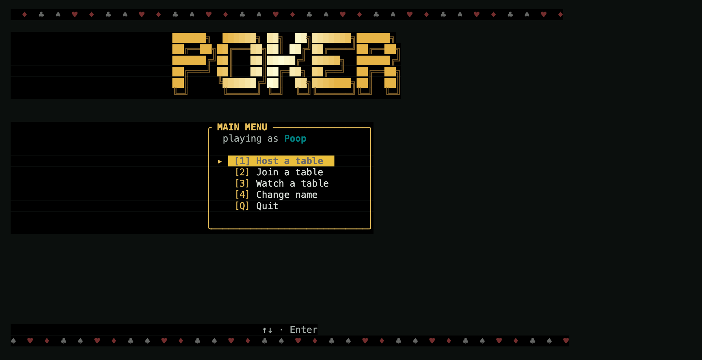
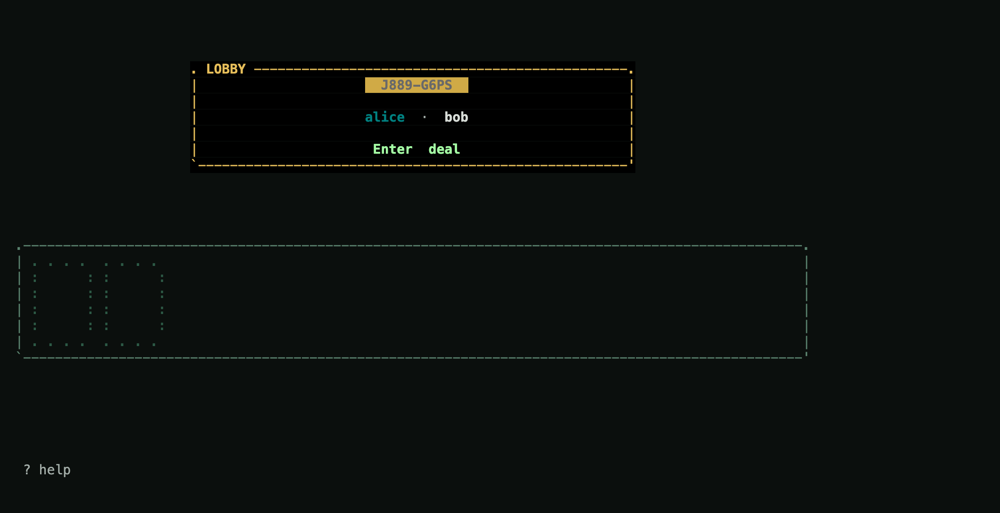
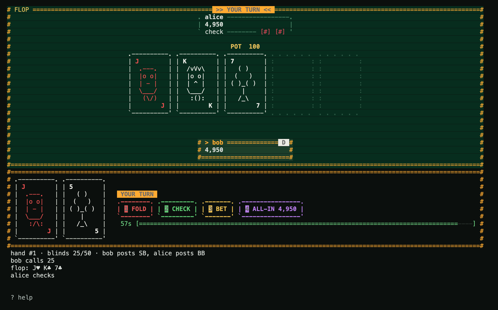
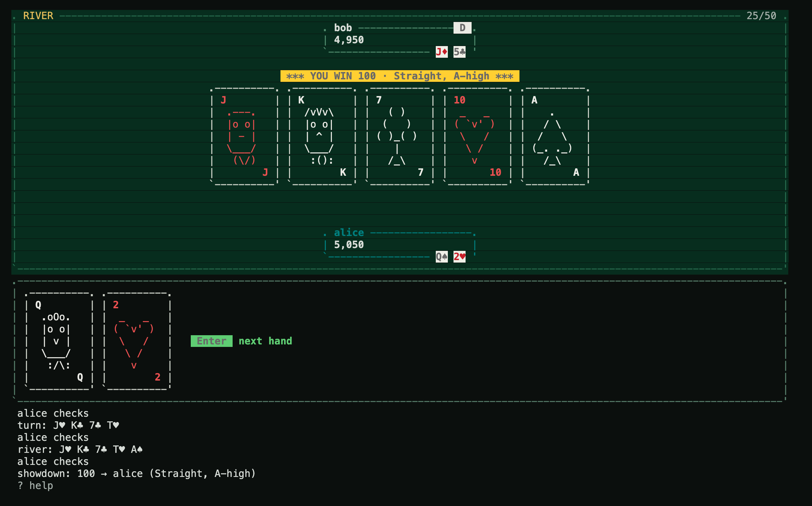

# pokertui

I just thought this would be a cool and easy way for me and my friends to play poker.

So I made this poker game that runs right in your terminal. One person hosts, everyone else joins using a 12-character room code. That's pretty much it.

There's no setup, no websites, no server to manage u just open up your terminal and play.

## Screenshots

**Menu**



**Lobby**



**Your turn** — the table border and buttons light up gold and the terminal bell rings



**Showdown**



## Getting started

**macOS / Linux / Raspberry Pi (64-bit)**

```bash
curl -fsSL https://raw.githubusercontent.com/ICYBAWSS/pokertui/main/install.sh | sh
```

**Windows (PowerShell)**

```powershell
irm https://raw.githubusercontent.com/ICYBAWSS/pokertui/main/install.ps1 | iex
```

**Just trying it? Run it without installing.** Nothing is kept: the game runs from a temporary folder and everything, including your saved name and hand history, is deleted when you quit.

```bash
curl -fsSL https://raw.githubusercontent.com/ICYBAWSS/pokertui/main/install.sh | sh -s -- --temp
```

On Windows:

```powershell
& ([scriptblock]::Create((irm https://raw.githubusercontent.com/ICYBAWSS/pokertui/main/install.ps1))) -Temp
```

**Or install directly with Rust:**

```bash
cargo install --git https://github.com/ICYBAWSS/pokertui --locked
```

Once installed, just run:

```bash
poker
```

You'll get a menu where you can host a game or join one using a code your friend gives you.

You can also use commands to jump in faster like:
```bash
poker join [code]
```

## Game modes

There are a few presets, depending on how you want to play.

| Game type | Blinds | Starting stack | Seats | Turn timer |
|---|---|---|---|---|
| Quick Game | 25/50 | 5,000 | 6 | 30s |
| High Roller | 500/1,000 | 100,000 | 6 | 45s |
| Turbo | 50/100 | 3,000 | 6 | 15s |
| Heads-Up | 50/100 | 5,000 | 2 | 30s |
| Custom | Your choice | Your choice | 2–9 | Your choice |

You can press `E` on any preset to change its settings before starting. Custom settings are saved for next time, too.

## Controls

Menus use the arrow keys and Enter, or you can press the number next to an option.

At the table:

| Key | Action |
|---|---|
| `1` | Fold |
| `2` | Check / Call |
| `3` | Raise |
| `4` | All-in |
| `Enter` | Deal next hand (host only) |
| `t` | Chat |
| `?` | Help |
| `Esc` | Leave the table |
| `Ctrl+C` | Quit |

The raise menu has a few shortcuts:

- `M` minimum raise
- `H` half pot
- `P` pot
- `A` maximum
- Left / Right arrows to adjust by a big blind
- Or just type an amount and hit Enter

Letter shortcuts `f`, `c`, `x`, `r`, and `a` also work.

A terminal size of at least 60×18 is required. 100×30 or larger looks a lot better.

## How it works

I wanted to avoid making anyone set up their own server just to play a game of poker. I also didn't want to pay for hosting indefinitely, especially for something I was mainly making for me and my friends. So instead, pokertui uses a public MQTT broker to pass messages between players. The host's game acts as the dealer and handles the actual poker logic. Everyone else's game just keeps up with the table.

A few things I had to figure out along the way:

- **Host-authoritative gameplay.** The host shuffles, deals, and validates every action. It sends out signed snapshots of the table, and clients only accept newer versions.
- **Signed messages.** Every packet is signed with Ed25519. The broker can drop or duplicate messages, but it can't just make up new ones or change existing ones.
- **Private hole cards.** Your cards aren't included in the public table state. They're encrypted and sent directly to your player key using X25519 and ChaCha20-Poly1305. Knowing the room code lets you watch the game, but not see everyone's cards.
- **Deck verification.** Before dealing, the host publishes a SHA-256 commitment to the deck. Once the hand is over, it reveals the original deck and nonce so anyone can verify that the deck wasn't changed during the hand.

## Under the hood

Heres basically how the players clients are communicating: 

```text
alice (host)                                  bob (client)
┌───────────────────────────────┐      ┌───────────────────────────────┐
│ ratatui UI                    │      │ ratatui UI                    │
│ game::Table                   │      │ client mirror                 │
│ net::host                     │     

## Extras

- **Bots:** press `+` as host, or `poker host --bots easy,medium,hard`.
- **Sit & Go tournaments:** pick it in the host menu. Blinds rise on a timer, last player wins.
- **Kick / ban:** as host press `k` (remove) or `K` (ban), then the seat number.
- **If the host drops,** the next player takes over and the table keeps going. If *you* drop, `poker rejoin` puts you back in your seat.
- **Rankings:** the menu or `poker rankings` shows everyone you've played with.
- **Fair shuffle:** every player adds randomness to each deal, and every finished hand is replayed and checked by every client.

More in [docs/EXPERIMENTAL_FEATURES.md](docs/EXPERIMENTAL_FEATURES.md).
